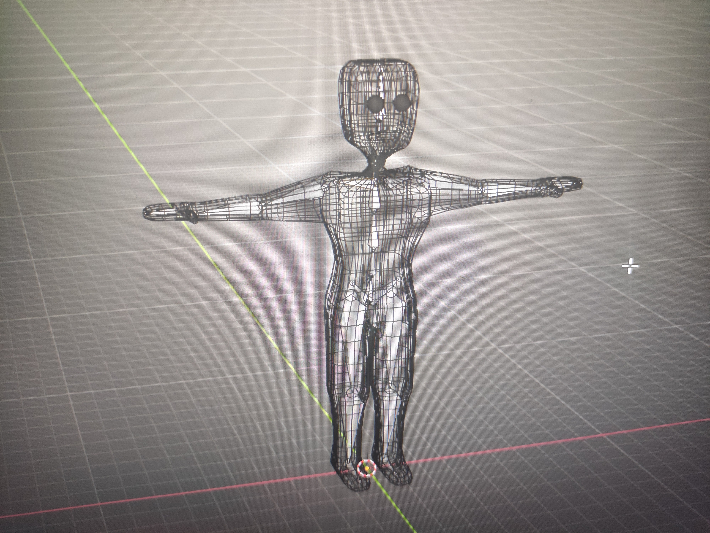

# Unity Multiplayer FPS

A small first-person multiplayer shooter I originally started as an experiment with Unity, C#, and [Mirror Networking](https://github.com/MirrorNetworking/Mirror). This was my **first attempt at making a multiplayer game**, and the main goal was never to create a polished competitive FPS. I wanted to find out how difficult it actually was to get two players into the same game, moving, shooting, and interacting with one another.

The game has since been revisited and brought to a playable state, with a few fixes and additions. The result is a simple host-client FPS that can be played with friends over a local network.

**[Download the playable Windows build (GitHub Release v1.0.0)](https://github.com/nikolasa004/UnityMultiplayerFPS/releases/tag/v1.0.0)**

## How this project started

When I first made this project, around five years ago, I wasn't particularly interested in developing 3D games. I preferred creating my own assets, usually as 2D pixel art, and 3D modeling seemed like a lot of extra work. Eventually I started wondering whether making deliberately simple low-poly models in Blender might not be much slower than drawing sprites after all.

So I tried it. I made the character myself, gave it colors, built a skeleton (rig), and animated it. I wasn't aiming for realism. The outstretched arms, awkward appearance, and intentionally silly animations were part of the fun. I wanted a goofy little character that would be entertaining to see running around and fighting other copies of itself.

The 3D character turned out to be the easier part. **Networking was the real challenge.**

I found multiplayer FPS tutorials and started learning Mirror. At the time, I understood very little about how multiplayer games actually worked. Even the relationship between a client and a server was confusing, let alone network ownership, commands, and messages sent back to clients. I eventually learned that one player could act as both the host/server and a player, but it took me a while to understand what the code was really doing.

What confused me most was seeing client-side and server-side operations mixed together in the same scripts. I was following tutorials, but I didn't yet have the background to understand *why* a command ran on the server or why a result had to be synchronized back to the clients. The documentation and examples also felt difficult to follow at the time. Looking at it now, after learning much more about software development and networking, many of those ideas seem far more straightforward.

Still, I managed to get the important parts working: two players could connect, their movement and animations could be synchronized, and they could shoot and eliminate each other. That was the original achievement I wanted from this project.

I left it largely as it was for years. When I returned to it, I decided to preserve that original experiment rather than rebuild it from scratch. I fixed some bugs, kept the simple low-poly environment, and added a few things such as player names and a kill scoreboard to make an actual 1v1 match more enjoyable. It is still a small, somewhat rough project, but now it is playable.

### The original character

This is the low-poly character I modeled, rigged, and animated in Blender:



## Playable build

The **[v1.0.0 release](https://github.com/nikolasa004/UnityMultiplayerFPS/releases/tag/v1.0.0)** contains `Multiplayer.zip`, a Windows build of the game.

1. Download **[Multiplayer.zip](https://github.com/nikolasa004/UnityMultiplayerFPS/releases/download/v1.0.0/Multiplayer.zip)** and extract it.
2. Launch the game's `.exe` from the extracted folder, keeping the other build files alongside it.
3. One player starts a **Host** session; another joins as a **Client**, using the host's address through the networking interface.
4. Play on the same local network (LAN). Both players should use the same build.

This is a **host-client** setup, not a permanently hosted public server. I mainly made and tested it as a small multiplayer experiment with another player, rather than as an online matchmaking game.

## What's in the game?

- First-person movement, running, jumping, and shooting
- Multiplayer synchronization through Mirror Networking and KCP
- Pistol shooting and reloading, with unlimited reserve ammunition
- Body hits, headshots, and visual/audio hit and kill feedback
- Ragdoll reactions when a player dies, followed by automatic respawning
- Player name entry and a synchronized kill scoreboard
- A low-poly map with streets, buildings, cover, rooftops, and ladders
- A custom low-poly character, rig, and animations

## Videos

Two separate videos show different sides of the project:

- **[Gameplay & Features Showcase](https://youtu.be/LvIg-4hW3U8)** - a slower demonstration of movement, shooting, animations, hits, deaths, and the map.
- **[1v1 Multiplayer Gameplay](https://youtu.be/xLoXrQz0EX4)** - an actual match between two players.

## Screenshots

A few views from the game, including the hit feedback, a kill, and the perspective after being eliminated:

| Spawn point | Cover and corridors |
| :---: | :---: |
|  |  |
| **Rooftops** | **View from the rooftop** |
|  |  |
| **Hit feedback** | **Firing from cover** |
|  |  |
| **Kill and ragdoll** | **After being eliminated** |
|  |  |
| **Shooting through an opening** | **Aiming across the map** |
|  |  |
## Source code and project files

This repository is **not a complete, ready-to-build Unity project**. I kept my own scripts, animations, original character model, selected adapted controller code, scene and prefab files, and Unity project configuration. Some third-party Asset Store packages and their original resources were intentionally excluded because I cannot assume I have permission to redistribute them as source assets.

As a result, opening the project directly in Unity will leave missing models, materials, effects, and other dependencies. **If you just want to try the game, use the Windows Release above.** The source files are here mainly to preserve and show how I approached the project.

The repository includes, among other things:

```text
UnityMultiplayerFPS/
├── Assets/
│   ├── Animacije/                  # Animation clips and controllers
│   ├── Controller/Scripts/         # Adapted first-person controller scripts
│   ├── MyScripts/                  # Multiplayer, shooting, respawn, and UI logic
│   ├── Scenes/                     # Unity scene (references excluded assets)
│   ├── ModelZaMultiplayer2.fbx     # My original character model
│   ├── Player.prefab
│   └── PlayerUI.prefab
├── Packages/
├── ProjectSettings/
├── docs/images/                   # Screenshots and Blender model photo
└── README.md
```

The last saved editor version in `ProjectSettings/ProjectVersion.txt` is **Unity 6000.6.6f1**. That is recorded for reference; the incomplete source project is not intended as a one-click setup.

## Credits and a final note

I made the character model, its rig and animations, and the project's own gameplay and networking scripts, while learning from tutorials and adapting some existing controller code. The project also uses **Mirror Networking**, **ParrelSync**, and third-party assets for parts of the environment, weapons, and effects. Not all visual assets shown in the playable build were made by me.

This game isn't a big or particularly sophisticated FPS. It is a snapshot of one of my earliest attempts to understand multiplayer programming - something that was genuinely confusing to me at the time. I wanted to keep that history visible, along with a build that people can actually play.
